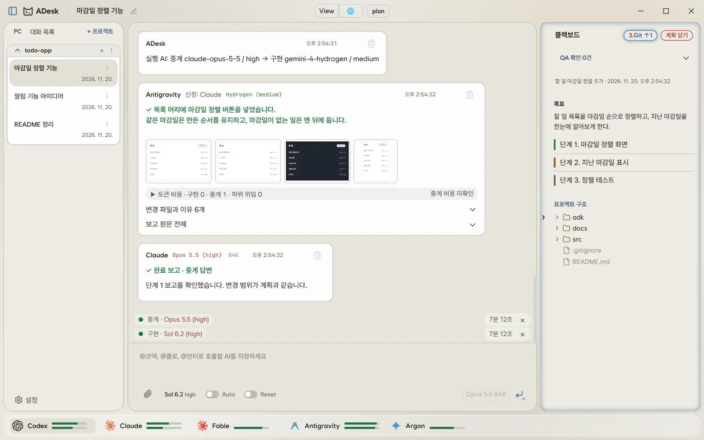

# ADesk

ADesk는 AI에게 맡기는 범위·비용·결과를 사람이 정하는 Windows 작업 환경입니다. Codex·Claude·Antigravity 구독을 한 창에 연결합니다.

<picture>
  <source media="(prefers-color-scheme: dark)" srcset="assets/chat-main-dark.webp">
  
</picture>

## 주요 기능

- 한 대화에서 `@코덱스`·`@클로드`·`@안티`로 AI를 부릅니다. 여러 AI를 함께 부르면 AI마다 따로 답합니다.
- 대화 위 할 일 칸에서 고칠 파일과 단계를 승인합니다. 프로젝트 맵은 파일별 역할을 전달합니다.
- 작업 난이도와 남은 한도로 실행 AI를 추천합니다. AI별 대화 맥락을 확인하고 실행 중에 지시를 더하거나 멈춥니다.
- 보고 카드에서 검증 결과와 사용자 확인 항목을 읽습니다. View에서 결과를 열고 비교합니다. 수락한 단계는 Git에 남깁니다.
- 설정에서 한국어와 English 중 화면 언어를 고릅니다.
- 개발자 한 명의 작업당 추정 비용 중앙값은 ADesk 중개 US$1.55, 외부 중개 US$8.71이었습니다. 비교 조건과 한계는 [운영 기록](https://windforsea.github.io/adesk-app/#evidence)에서 확인하세요.

## 설치

- Windows 10·11 64비트에서 동작합니다. Python은 앱에 들어 있습니다.
- Codex·Claude·Antigravity 가운데 하나만 구독해도 됩니다.
- [배포 사이트](https://windforsea.github.io/adesk-app/)에서 `ADesk-Setup.exe`를 내려받아 실행합니다. 설치 방법과 문제 해결도 사이트에 있습니다.
- 바뀐 내용은 [업데이트 내역](https://windforsea.github.io/adesk-app/updates.html)에 있습니다.

## 이 저장소

이 저장소는 배포 사이트(GitHub Pages)와 릴리스를 담습니다. 앱 소스 코드는 각 릴리스의 ZIP 파일(`adesk-<버전>.zip`)에 들어 있습니다.

## 라이선스

- ADesk는 [MIT 라이선스](LICENSE)를 따릅니다.
- 함께 배포하는 다른 소프트웨어의 라이선스는 릴리스 ZIP의 `adesk/data/licenses/THIRD_PARTY_NOTICES.md`에 있습니다.
- MIT 라이선스는 "ADesk" 이름을 쓸 권리를 주지 않습니다. 고친 판을 배포할 때는 다른 이름을 써 주세요.
- OpenAI·Codex는 OpenAI의 상표이고, Claude는 Anthropic의 상표이며, Gemini·Antigravity는 Google의 상표입니다. ADesk는 이 회사들과 제휴 관계가 없습니다.

## 후원

[배포 사이트의 후원 영역](https://windforsea.github.io/adesk-app/#donate)에서 개발을 후원할 수 있습니다.
